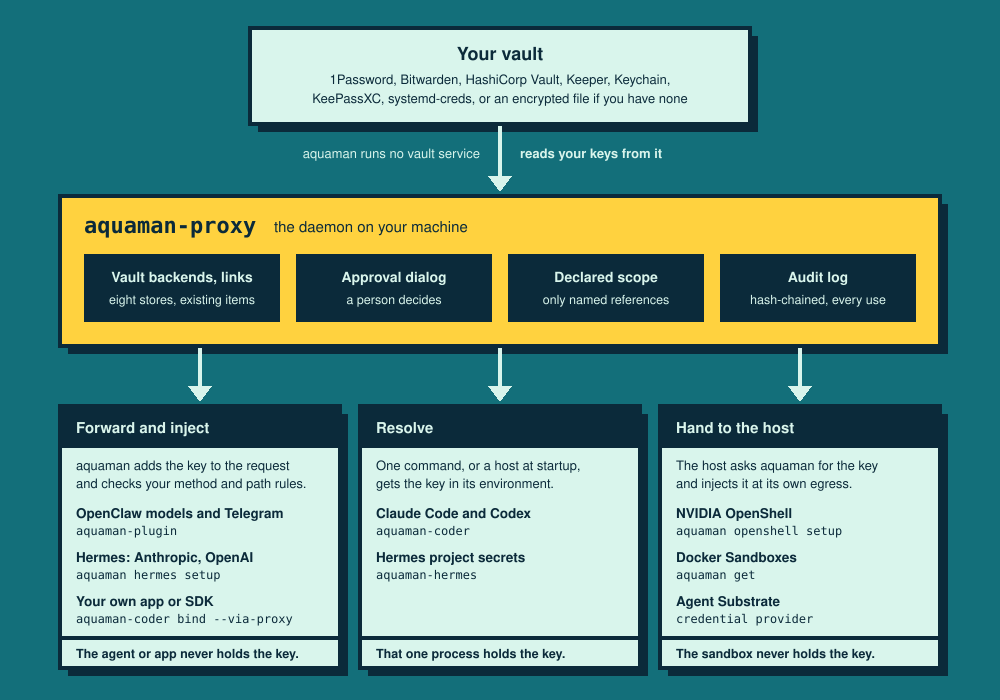

# Package boundaries — the rules we follow

Aquaman is a monorepo with four packages. Each has a sharp, named role. We keep them separate to maintain scanner-stable boundaries, allow independent versioning when needed, and avoid the "shared stuff with no clear role" failure mode that killed the original `packages/core`.

## How the packages fit together

`aquaman-proxy` is the core: it is the only package that reads the vault, shows the approval dialog, checks the declared scope and writes the audit log. The other packages are adapters that connect one kind of host to it. A key leaves the daemon in one of three ways, and every integration is one of them:

| Hand-off | In the daemon | Who uses it | Who holds the key |
|---|---|---|---|
| **Forward and inject** | the two listeners in `daemon.ts`; request policy applies | `aquaman-plugin` (OpenClaw model keys and Telegram), `aquaman hermes setup` (Hermes model keys, Anthropic and OpenAI providers), `aquaman-coder bind --via-proxy` (an app through `/broker/route`) | the daemon only |
| **Resolve** | `POST /broker/resolve`, limited by `broker-scope.ts` | `aquaman-coder exec` and its hooks, the `aquaman-hermes` secret source, `aquaman get` behind a host's helper command | the process that asked |
| **Hand to the host** | the OpenShell credential driver (`src/openshell/`), the Agent Substrate credential provider (`src/substrate/`), and `aquaman get` behind `sbx secret set --command` | NVIDIA OpenShell, Agent Substrate, Docker Sandboxes | the host's injector, outside its sandbox |

Method and path rules exist only in the first row, because only there does the request pass through the daemon. A new integration picks the first hand-off the host allows, in that order.

## packages/proxy — `aquaman-proxy` on npm

**Role:** the canonical slim core daemon.

**Owns:**
- Vault backend abstraction and 8 backend implementations (Keychain, 1Password, HashiCorp Vault, KeePassXC, encrypted-file, systemd-creds, Bitwarden, Keeper): `src/core/credentials/`
- Hash-chained audit log, anchored in the credential store (`src/audit-anchor.ts`) — `src/core/audit/`
- HTTP/UDS proxy daemon with credential header injection — `src/daemon.ts`
- Service registry (builtin service definitions) — `src/service-registry.ts`
- Request policy engine — `src/request-policy.ts`
- Broker endpoints (`POST /broker/resolve` and the other `/broker/*` paths): `src/daemon.ts`, scope in `src/broker-scope.ts`
- The two host integrations that have no package of their own, because the host asks the daemon directly: the OpenShell credential driver (`src/openshell/`) and the Agent Substrate credential provider (`src/substrate/`)
- Base CLI: `init`, `daemon`, `status`, `doctor`, `credentials`, `audit`, `policy`, `migrate` — `src/cli/`

**Does not import** the plugin or the coder package. Code for one agent host belongs in that host's adapter, with the exceptions named here: the transitional OpenClaw helpers below, the Hermes setup command (the Python package cannot run it), and the two sandbox-host integrations above.

**Transitional exception (v0.12.0):** OpenClaw-aware helpers in `src/openclaw/` and the OpenClaw-aware branches in the proxy CLI (the `aquaman openclaw` namespace — `setup`, `doctor`, `status`, `start`, `configure`, `migrate`, `plugin-mode`) are inherited from the v0.11.x architecture. The carve-out into `packages/plugin` is a v0.13.0+ refactor. The `aquaman coder` namespace is a **shim** that execs the `aquaman-coder` binary, not an import — so the boundary holds. **No new agent-aware code is imported into proxy under any circumstances.**

## packages/plugin — `aquaman-plugin` on npm + ClawHub

**Role:** the OpenClaw adapter.

**Owns:** everything OpenClaw-aware — plugin manifest, plugin entry (`index.ts`), `openclaw.plugin.json`, OpenClaw env-writer, OpenClaw integration helpers, OpenClaw CLI command registration. After the v0.12.0 carve-out, also owns the OpenClaw setup logic (moved out of proxy CLI).

**Scope is frozen.** Code added here only for:
- OpenClaw compat fixes
- ClawScan / scanner remediation
- Manifest / config schema changes
- Bug fixes for OpenClaw-specific behavior

**Not in scope:** new coding-agent code, cross-agent CLI commands.

## packages/coder — `aquaman-coder` on npm (NEW v0.12.0)

**Role:** the coding-agent adapter for Claude Code, Codex, and any future coding agent.

**Owns:**
- Per-agent hook handlers (`src/adapters/<agent>/hook.ts`)
- Per-agent setup writers (`src/adapters/<agent>/setup.ts`)
- Project credential map resolver (`~/.aquaman/projects.yaml`) — `src/projects/`
- Secret-pattern redactor — `src/redactor/`
- `aquaman-coder exec` helper — `src/exec.ts`
- `aquaman-coder` CLI: `setup <agent>`, `project <verb>`, `get <key>`, `exec <cmd>`, `hook --target <agent>`, `doctor`

**Does not know about:** OpenClaw.

**Depends on:** `aquaman-proxy` (exact pin) for vault access via the UDS broker endpoint.

## packages/hermes: `aquaman-hermes` on PyPI

**Role:** the Hermes adapter, in Python.

**Owns:** the status surface and the `aquaman` secret source that Hermes loads as a plugin.

**Holds no isolation logic.** Hermes provider keys are kept out of the Hermes process by the daemon's loopback listener, which `aquaman hermes setup` (in `aquaman-proxy`) wires up. This package talks to the daemon over that listener only; there is no code import in either direction.

## Cross-package imports

| Direction | Allowed? |
|---|---|
| `plugin` → `proxy` | ✓ Yes (plugin starts daemon, may import shared types) |
| `coder` → `proxy` | ✓ Yes (coder talks to broker endpoint, may import shared types) |
| `plugin` → `coder` | ✗ No |
| `coder` → `plugin` | ✗ No |
| `proxy` → `plugin` or `coder` | ✗ No (proxy is agent-agnostic) |

If you find yourself needing a forbidden import direction, the code probably belongs in a different package, or a shared type needs to be promoted into `proxy/src/core/` where both can consume it.

## When to add a new package

The default answer is **"no, organize inside an existing package."** Add a new package only when at least one of these holds:

- A subdirectory exceeds ~5,000 LOC **AND** has independent versioning needs (e.g., a single agent adapter is moving fast enough to warrant its own release cadence).
- An external registry (an agent's own plugin marketplace, like OpenClaw's ClawHub) requires a standalone published unit.
- A scanner finding can only be resolved by isolating a code path into its own published unit.

## What killed the old `packages/core`

The original v0.6.x monorepo had a `packages/core` scoped as "shared stuff between proxy and plugin." Without a clear named role, code drifted in without anyone asking "does this actually need to be cross-cutting?" The result was poor cohesion — eventually folded back into `packages/proxy` during the v0.7.0 cleanup.

**Lesson:** every package name should declare what the package is *for* in one word. `proxy` = the daemon. `plugin` = the OpenClaw adapter. `coder` = the coding-agent adapter. `hermes` = the Hermes adapter. If a future package can't be summarized in one word, it doesn't have a clear role and shouldn't exist yet.
